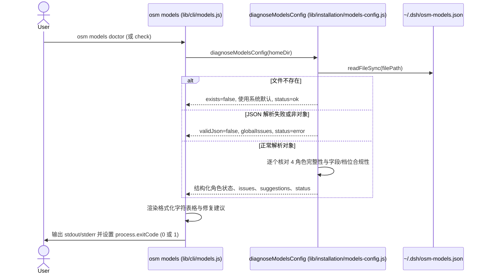

# 模型配置可观测性诊断 (osm models doctor) 系统方案与公共契约设计

> **设计结论**：在 `lib/installation/models-config.js` 抽象出底层模型配置结构化诊断接口 `diagnoseModelsConfig(homeDir)`，统一定义合法 reasoningEffort 档位集合；在 `lib/cli/models.js` 扩充 `doctor` 与 `check` 子命令，提供轻量字符对齐诊断表格输出、精确问题定位、一键修复建议与严格退出码（0/1），并在现有测试套件中建立完备断言保护。

## Current 基线与变更范围

### 受影响 Current Truth

| Current 文档 / 模块 | Current | Delta | Target |
| --- | --- | --- | --- |
| `lib/installation/models-config.js` | 仅有 `loadModelsConfigWithDiagnostics`，将读取/解析/字段问题扁平收集为字符串 `problems`，缺乏档位白名单与结构化诊断 | 新增 `VALID_REASONING_EFFORTS` 常量与 `diagnoseModelsConfig` 结构化函数，区分文件级、角色级缺陷与修复建议 | 成为模型配置解析、档位校验、诊断结构化的单一事实源 |
| `lib/cli/models.js` | 仅支持 `list` (或 `show`)、`set`、`reset`，未知子命令提示仅包含 `list/set/reset` | 增加 `doctor` 与 `check` 分支，格式化渲染对齐诊断表格与建议命令，更新帮助提示 | 提供主动式终端诊断与自动化排查工具 |
| `docs/02-product/P02-modules/P02-03-installation.md` | 文档中仅记录 `osm models list/set/reset` | 补充 `osm models doctor` (别名 `osm models check`) 说明与输出范式 | 用户与系统文档保持同步 |

## 总体方案与主流程

### 总体方案

1. **核心校验内核下沉**：
   将诊断核心逻辑置于 `lib/installation/models-config.js`，保持纯逻辑、无 I/O 副作用（可指定 `homeDir`，易于单元测试模拟）。
   诊断覆盖 3 级检查：
   - Level 1: 文件可读性与 JSON 语法合法性、顶层对象类型。
   - Level 2: 角色覆盖率（4 个核心角色：`architect`, `worker`, `explorer`, `librarian`）与未知冗余角色检测。
   - Level 3: 角色属性合规性（`provider`、`model` 必填非空字符串，`reasoningEffort` 必须在合法集合内）。
2. **轻量格式化输出展示**：
   在 `lib/cli/models.js` 中使用原生字符串填充实现终端对齐表格，输出角色、当前 Provider、Model、Effort 与状态（`OK`、`MISSING`、`INVALID`、`DEFAULT`）。
   下方聚合分类列出具体问题原因，并生成即时可用的修复命令（如 `osm models set ...` 或 `osm models reset`）。
3. **确定性退出码**：
   若全项合格或未配置时回退默认且无需阻断，返回 `0`；
   若存在语法损坏、必填字段缺失或非法值，返回 `1`。

### 业务流程 / 主时序



## 关键契约设计

### 1. 结构化诊断契约 (`diagnoseModelsConfig`)

```typescript
interface RoleDiagnosis {
  role: 'architect' | 'worker' | 'explorer' | 'librarian';
  configured: boolean; // 用户文件中是否显式写了该角色
  provider: string;
  model: string;
  reasoningEffort: string;
  status: 'ok' | 'default' | 'error';
  issues: string[];
  suggestions: string[];
}

interface ModelsConfigReport {
  filePath: string;
  exists: boolean;
  validJson: boolean;
  topLevelObject: boolean;
  globalIssues: string[];
  roles: Record<string, RoleDiagnosis>;
  unknownRoles: string[];
  overallStatus: 'ok' | 'error';
  exitCode: 0 | 1;
}
```

### 2. 合法思考档位常量 (`VALID_REASONING_EFFORTS`)

根据主流推理模型及 DSH 规范，允许的取值集合为：
`['none', 'low', 'medium', 'high', 'xhigh', 'max', 'default']`。
若配置中该字段缺失，则继承角色默认值；若显式配置了不在该集合内的值（如 `ultra`、`super`），判定为 `INVALID_EFFORT` 错误。

### 3. 表格渲染样式规范

```text
Open Spec Mesh 模型配置诊断报告 (~/.dsh/osm-models.json):

┌────────────┬──────────────────┬───────────────────────┬─────────┬─────────┐
│ 角色       │ Provider         │ Model                 │ Effort  │ 状态    │
├────────────┼──────────────────┼───────────────────────┼─────────┼─────────┤
│ architect  │ fatfei-codex     │ gpt-6.1-sol           │ xhigh   │ OK      │
│ worker     │ opencode-go      │ deepseek-v4.1-flash   │ max     │ OK      │
│ explorer   │ fatfei           │ gemini-3.8-flash-high │ high    │ OK      │
│ librarian  │ fatfei           │ gemini-3.8-flash-high │ high    │ OK      │
└────────────┴──────────────────┴───────────────────────┴─────────┴─────────┘

✔ 所有 4 个核心角色模型配置合规。
```

当存在异常时：
```text
┌────────────┬──────────────────┬───────────────────────┬─────────┬─────────┐
│ 角色       │ Provider         │ Model                 │ Effort  │ 状态    │
├────────────┼──────────────────┼───────────────────────┼─────────┼─────────┤
│ architect  │ fatfei-codex     │ gpt-6.1-sol           │ xhigh   │ OK      │
│ worker     │ (missing)        │ deepseek-v4.1-flash   │ max     │ ERROR   │
│ explorer   │ fatfei           │ gemini-3.8-flash-high │ ultra   │ ERROR   │
│ librarian  │ (default)        │ (default)             │ (def)   │ DEFAULT │
└────────────┴──────────────────┴───────────────────────┴─────────┴─────────┘

❌ 发现 2 个配置问题:
  - worker: 缺少必填字段 provider
  - explorer: reasoningEffort 档位 "ultra" 非法，可选档位: none, low, medium, high, xhigh, max, default

💡 一键修复建议:
  osm models set worker --provider opencode-go
  osm models set explorer --effort high
```

## 关键决策

### D001｜将诊断逻辑独立为纯函数 `diagnoseModelsConfig`
- **结论**：不把诊断逻辑直接硬编码在 CLI 处理函数中，而是下沉至 `lib/installation/models-config.js`。
- **原因**：支持可测试性，方便单测传入独立 `homeDir` 进行精确断言，未来亦可被 SDK 或 DSH 插件其他部分调用。
- **影响**：`models-config.js` 增加导出，保持已有 `loadModelsConfigWithDiagnostics` 契约不变。

### D002｜双子命令支持（`doctor` 与 `check` 互为别名）
- **结论**：同时支持 `osm models doctor` 与 `osm models check`。
- **原因**：满足用户习惯差异（Homebrew/Flutter 风格的 `doctor` 与大多数 linter 风格的 `check`），消除记忆负担。
- **影响**：CLI 参数分发统一指向同一处理函数。

### D003｜退出码与自动化集成
- **结论**：仅在存在真实影响运行的格式损坏、缺少必填字段或非法档位时退出码设为 1；文件不存在时由于系统有完整健全的 `DEFAULT_MODELS` 回退兜底机制，视为健康（状态提示使用默认），退出码为 0。
- **原因**：新安装环境下用户尚未配置自定义模型时，不应导致自动化验证流程中断报错。

## Task 划分与计划预览


| Task | 交付内容 | 前置任务 | 验收准则 |
| --- | --- | --- | --- |
| **T01** | `models-config.js` 中实现 `VALID_REASONING_EFFORTS`、`diagnoseModelsConfig` 及对应单元测试 | 无 | AC-01, AC-02, AC-03, AC-04 |
| **T02** | `lib/cli/models.js` 实现 `doctor`/`check` 子命令、表格格式化排版、建议生成与 exitCode 控制 | T01 | AC-01, AC-02, AC-03, AC-04, AC-05 |
| **T03** | 更新相关文档（`docs/02-product/` 及 CLI 帮助信息），跑通全量测试套件 | T02 | AC-05，全量回归通过 |
