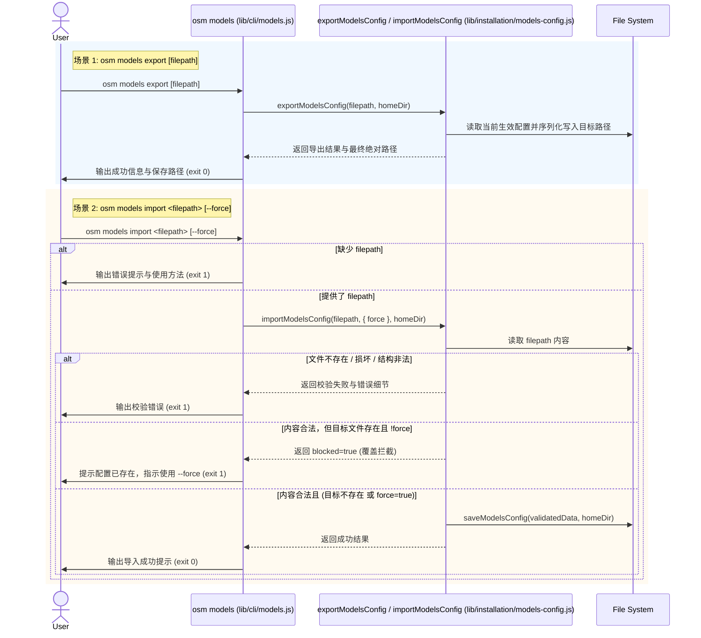

# 模型配置备份与还原 (osm models export / import) 系统方案与公共契约设计

> **设计结论**：在 `lib/installation/models-config.js` 扩展模型配置导出与导入核心内核函数 `exportModelsConfig(targetPath, homeDir)` 与 `importModelsConfig(sourcePath, options, homeDir)`，内建基于 `VALID_REASONING_EFFORTS` 与 4 核心角色的严密校验体系与覆盖保护机制；在 `lib/cli/models.js` 中接入 `export [filepath]` 与 `import <filepath> [--force]` 子命令分发，提供友好终端输出提示与确定性退出码（0/1）。

## Current 基线与变更范围

### 受影响 Current Truth

| Current 文档 / 模块 | Current | Delta | Target |
| --- | --- | --- | --- |
| `lib/installation/models-config.js` | 仅支持读取合并 (`loadModelsConfig`)、诊断 (`diagnoseModelsConfig`) 与覆写保存 (`saveModelsConfig`)，无导出导入与配置源导入校验逻辑 | 新增 `exportModelsConfig` 与 `importModelsConfig`，配套导入语法、角色与档位校验及覆盖保护逻辑 | 成为模型配置读写、诊断、备份与还原的核心事实源与操作内核 |
| `lib/cli/models.js` | 仅支持 `list`/`show`, `doctor`/`check`, `set`, `reset`；缺少配置导出与还原入口 | 新增 `export [filepath]` 与 `import <filepath> [--force]` 分支，处理缺省路径、`--force` 覆盖判断、友好输出及退出码 | 提供完整的配置导出备份与安全还原 CLI 入口 |
| `docs/02-product/P02-modules/P02-03-installation.md` | 仅记录 `list|doctor|check|set|reset` | 补充 `export` 与 `import` 命令用法、默认导出路径及 `--force` 覆盖说明 | 用户与产品文档保持事实一致 |

## 总体方案与主流程

### 总体方案

1. **导出内核 (`exportModelsConfig`)**：
   - 支持缺省目标路径：若未指定 `targetPath`，自动回退到工作区根目录的 `osm-models-backup.json`（`path.resolve(process.cwd(), 'osm-models-backup.json')`）；若指定则自动解析并创建必要父目录。
   - 导出当前生效的完整 4 个角色配置（经 `loadModelsConfig` 深合并后保证完备性），输出 2 空格缩进的美化 JSON。
2. **导入内核 (`importModelsConfig`)**：
   - 来源校验：检查 `<filepath>` 存在性，校验 JSON 语法、顶层对象类型。
   - 语义合规校验：必须包含 4 个核心角色（`architect`, `worker`, `explorer`, `librarian`），每个角色必须具备非空的 `provider` 与 `model`，且 `reasoningEffort` 必须在 `VALID_REASONING_EFFORTS` 白名单内。
   - 覆盖防护门禁：检查目标文件（`~/.dsh/osm-models.json`）是否存在。若已存在且未提供 `force: true`，拒绝写入并返回 `blocked: true`，明确提示需使用 `--force`；仅当文件不存在或显式指定 `force: true` 时，才执行持久化保存。
3. **CLI 分发与终端呈现**：
   - `osm models export [filepath]`：解析可选路径参数，打印成功导出的绝对/相对路径。
   - `osm models import <filepath> [--force]`：严格检查 `<filepath>` 参数，支持 `--force` / `-f` 标志，拦截未确认的覆盖操作并给出明确引导，严格依据执行结果返回 0 或 1。

### 业务流程 / 主时序



## 关键契约设计

### 1. 导出内核方法签名

```typescript
interface ExportResult {
  success: boolean;
  targetPath: string;
  config: Record<string, { provider: string; model: string; reasoningEffort: string; description?: string }>;
}

export function exportModelsConfig(targetPath?: string, homeDir?: string): ExportResult;
```

### 2. 导入内核方法签名与返回类型

```typescript
interface ImportOptions {
  force?: boolean;
}

interface ImportResult {
  success: boolean;
  targetPath: string;
  blocked?: boolean;
  errors?: string[];
  reason?: string;
  config?: Record<string, any>;
}

export function importModelsConfig(sourcePath: string, options?: ImportOptions, homeDir?: string): ImportResult;
```

### 3. 校验规则与错误分类

1. **源文件级错误**：
   - 文件不存在：`源文件不存在: ${resolvedPath}`
   - JSON 语法错误：`JSON 解析失败: ${error.message}`
   - 顶层非对象：`配置内容格式错误: 顶层必须为非空对象`
2. **角色与字段级错误**：
   - 缺少核心角色：`缺少必要角色配置: ${missingRoles.join(', ')}`
   - 角色字段缺失：`角色 ${role} 缺少必填字段 provider 或 model`
   - 非法思考档位：`角色 ${role} 的 reasoningEffort "${effort}" 不合法，有效档位: ${VALID_REASONING_EFFORTS.join(', ')}`
3. **覆盖冲突错误**：
   - 目标已存在且未指定 force：`目标配置文件已存在 (~/.dsh/osm-models.json)，若需覆盖请追加 --force 选项`

## 兼容性与确定性设计

- **向后兼容**：不改变原有 `loadModelsConfig`、`saveModelsConfig`、`diagnoseModelsConfig` 的外部行为。
- **环境隔离友好**：所有导出与导入函数均支持接收 `homeDir` 参数（以及使用 `process.cwd()`），天然便于在单元测试中使用临时目录（`mkdtempSync`）进行无副作用测试。
- **纯原生依赖**：使用 Node.js 内置 `node:fs` 与 `node:path`，零外部依赖。
