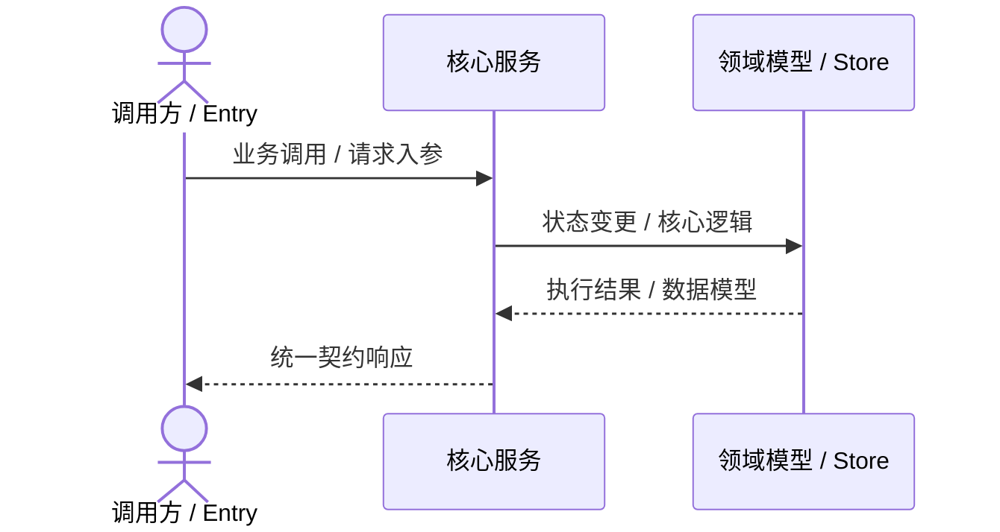

# 整体设计

> **设计结论**：说明本次变更的核心技术方案概述与结论。

## Current 基线与变更范围

### 受影响模块与 Current Truth

说明 Current → Delta → Target 和受影响能力。

| 模块 / 文档 | Current 基线 | Delta 增量变更 | Target 目标状态 |
| --- | --- | --- | --- |
| 待补充 | 待补充 | 待补充 | 待补充 |

## 总体方案与主流程

### 总体方案

模块职责划分、协作链路与技术选型；引用需求，不重复背景与业务验收标准。区分必须遵守的硬性约束、推荐方案与待验证假设。

### 核心时序与调用流

## 公共接口与契约变更

列出跨模块公共 API、CLI 命令、协议或导出符号变更清单（内部私有函数由 Worker 自由决定，不在此列）：

| 接口 / 符号 | 类型 (API/CLI/Schema) | 变更类型 (新增/修改/弃用) | 参数与返回值契约 | 破坏性变更 (Breaking?) |
| --- | --- | --- | --- | --- |
| 待补充 | API | 新增 | 待补充 | 否 |

## 数据与表结构变更

| 表 / 配置项 / 文件 | 变更内容 | 索引 / 约束 | 迁移与兼容策略 |
| --- | --- | --- | --- |
| 待补充 | 待补充 | 待补充 | 待补充 |

## 领域模型与状态变更

说明核心实体、值对象变更及生命周期状态机流转。

## 关键架构决策 (ADR)

### D001｜决策标题

- **上下文与问题**：待补充。
- **决策结论**：待补充。
- **选择原因**：待补充。
- **被否决方案及原因**：待补充。
- **架构影响与权衡**：待补充。

## 公共设计与不变量

- **事务与一致性**：待补充。
- **幂等性与并发控制**：待补充。
- **失败恢复与容灾重试**：待补充。
- **向后兼容与平滑降级**：待补充。

## 实现自由度与边界 (Implementation Boundaries)

- **Worker 完全自治范围**：模块私有函数划分、类与结构体局部设计、私有测试用例编写均由 Worker 自主决策，**严禁要求 Worker 事先输出详细设计文档或伪代码**。
- **不可突破的硬性边界**：本设计明确的公共 API 契约、数据 Schema、跨模块目录读写边界以及安全红线。
- **偏差处理**：Worker 遇到局部实现问题自行在模块内重构纠错；仅当发现整体设计公共契约存在缺陷或无法满足需求时，方可上抛。

## 人工确认

待用户评审确认整体设计；确认前不自动开始拆解任务（C03）或执行编码。
